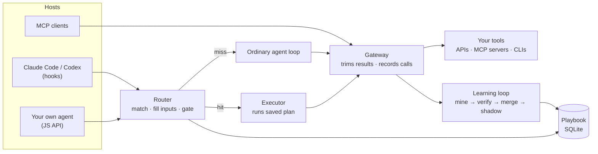
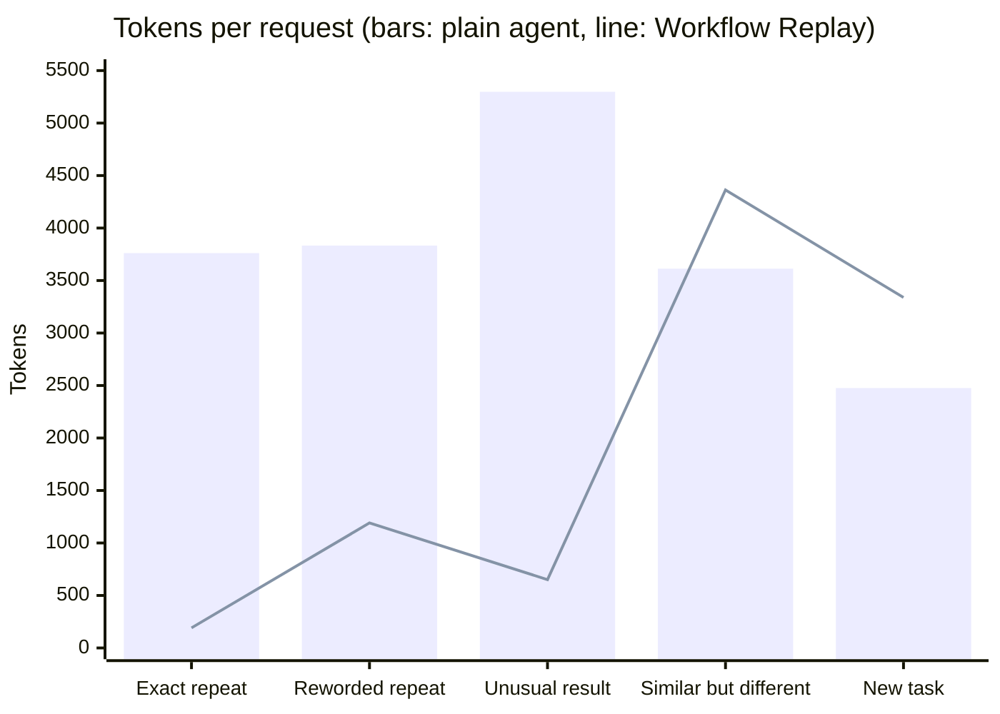

<div align="center">

# Workflow Replay

**Stop paying your AI agent to redo the same tool calls.**

Workflow Replay watches the tool calls your agent makes, learns the read-only workflows it keeps repeating, and replays them the next time a similar request comes in. The model gets a short, verified result instead of re-planning, re-calling and re-reading raw API output.


[What it does](#what-it-does) · [How it works](#how-it-works) · [Results](#results) · [Quick start](#quick-start) · [Usage](#usage) · [Safety](#safety) · [Docs](#documentation)

</div>

> [!NOTE]
> Workflow Replay pays off when the same **kinds of read-only lookups** come up again and again: order status, account summaries, ticket counts, ERP or CRM queries, support bots. It does little for open-ended work such as writing code. Run the [built-in analyzer](#1-measure-first) on your own history before you deploy it.

## Contents

- [What it does](#what-it-does)
- [How it works](#how-it-works)
- [Results](#results)
- [Who benefits](#who-benefits)
- [Quick start](#quick-start)
- [Usage](#usage)
- [Safety](#safety)
- [Reproduce the benchmark](#reproduce-the-benchmark)
- [Project layout](#project-layout)
- [Limitations](#limitations)
- [Documentation](#documentation)

## What it does

Agents spend most of their tokens on tool calls: deciding what to call, calling it, then reading the full raw response back in. Each extra turn re-sends the whole conversation. When the same request comes back with different values ("status of order #W123", then "#W456"), the agent does all of that again from scratch.

Workflow Replay sits between the agent and its tools and:

- **Learns** workflows automatically from the agent's own successful runs: which calls, in what order, with which values coming from the request and which from earlier results. It handles loops, pagination, filtered counts and totals.
- **Verifies** each learned workflow by replaying it against past runs, then runs it in **shadow mode** next to the real agent before it goes live.
- **Replays** matching requests before the model starts working, or mid-turn when the model's first tool call matches a known workflow, and hands the model a compact receipt (`item_count=5; total=3819.12`) to answer from.
- **Keeps the model in charge.** By default the model still writes every answer, using the receipt and the conversation, so answers stay context-aware and get checked. Unusual results are flagged to it.
- **Never writes on its own.** Workflows that change data only prepare the exact action; it runs once, after your Claude Code permissions allow it or you approve it.

## How it works



**First time a task is seen:** the agent works normally. Every call goes through the gateway, which trims results to the fields that matter and records the run.

**After a few similar runs:** the miner groups runs by call shape, works out which values are inputs, and compiles a plan. It's checked against past runs, then shadowed against the live agent. Routine consolidation merges near-duplicate plans: two plans that differ only in a fixed value become one plan with a placeholder.

**When a similar request comes back:**

```mermaid
sequenceDiagram
  participant U as User
  participant H as Hook / host
  participant R as Router
  participant X as Saved plan
  participant M as Model
  U->>H: "Where is order #W456?"
  H->>R: request text
  R->>R: find candidate, fill inputs, safety gate
  alt verified match
    R->>X: run with order_id = #W456
    X-->>H: order_id=#W456; status=delivered; tracking=…
    H->>M: request + compact receipt (no tool calls needed)
    M-->>U: answer
  else no safe match
    H->>M: ordinary turn (tools trimmed, workflows offered)
  end
```

<details>
<summary>What the safety gate checks</summary>

- Every input value must appear in the request (or in a result carried from earlier in the conversation).
- Words that change the question ("first" instead of "latest", "unavailable", "cancel", "zip" instead of "city") decline the match unless the workflow was learned with them.
- A learned filter ("delivered" orders) must be mentioned in the request.
- Terms that belong only to a competing workflow decline the match.
- Mid-turn replays (the compiled `run_workflow` tool and gateway speculation) pass the same gate as pre-model routing.

</details>

## Results

Measured on real records from the public [τ²-bench](https://github.com/sierra-research/tau2-bench) retail and airline databases (500 customers, 1,000 orders, 2,000 reservations), with **DeepSeek V4.1 Flash**. There are 69 test requests × 2 repeats × 3 arms, run in random order. Learning happened first, on different customers.

| | Plain agent | **Workflow Replay** (model writes every answer) |
| --- | --- | --- |
| Accuracy | 99.3% | **100%** |
| Tokens per request | 4,026 | **2,489 (−38%)** |
| Estimated cost* | — | **−17%** |
| Model calls per request | 2.97 | **2.62** |
| Median latency | 2.6 s | **2.0 s** |
| Wrong answers caused by a replay | — | **0** of 44 tricky controls |

\* Cost units weight uncached input 1×, cached input 0.1× and output 2×.



| Request type | Plain agent | Workflow Replay | Change |
| --- | --- | --- | --- |
| Repeat, same wording | 3,761 | 191 | **−95%** |
| Repeat, new wording | 3,833 | 1,191 | **−69%** |
| Repeat with an unusual result (flagged to the model) | 5,298 | 651 | **−88%** |
| Similar wording, different question | 3,613 | 4,363 | +21% |
| Never-seen task | 2,476 | 3,339 | +35% |

> [!TIP]
> Repeats get much cheaper and everything else gets a bit more expensive, so **break-even is roughly 35% repeat traffic**. If you let the harness skip the model on clean hits (opt-in), repeats cost nothing and the totals go to −42% tokens and −30% cost.

Full method, every run (including the ones that went wrong and what fixed them) and limits: [docs/v2-results.md](docs/v2-results.md).

## Who benefits

| You run… | Expect |
| --- | --- |
| A support bot or internal assistant answering the same kinds of lookups all day | Large savings on the repeated share, faster answers |
| Claude Code or Codex against company APIs (ERP, CRM, ticketing) where you ask the same questions repeatedly | Good savings on those lookups; the model still writes every answer |
| Claude Code for everyday coding | Little to none. The analyzer found 0.5% replayable turns in 596 coding turns |
| One-off research or writing | None; nothing repeats |

## Quick start

**Prerequisites:** Node.js 24 or later. Claude Code and/or Codex if you want the automatic hooks.

```bash
git clone https://github.com/owentw23/workflow-replay.git
```

```bash
cd workflow-replay && npm ci
```

### 1. Measure first

```bash
npm run analyze
```

This scans your local Claude Code transcripts and prints only totals: how many turns were read-only lookups that repeat, their share of your tokens, and a savings ceiling. Nothing leaves your machine.

### 2. Create a profile for your service

A profile tells the harness which operations exist and whether each one reads or writes. Generate one from what you already have:

```bash
npm run wrap -- mcp my-service --read-only -- node path/to/your-mcp-server.mjs
```

```bash
npm run wrap -- openapi my-api --spec openapi.json --base https://api.example.com --token-env MY_API_TOKEN
```

Each operation is labelled `read` or `write`, with the reason. Unclear operations are labelled `write`, so they need approval. `--read-only` drops write operations entirely, which is the right choice for systems that must never be changed. Review the generated file in `~/.workflow-replay/v2/profiles/`.

### 3. Install into Claude Code and Codex

```bash
npm run setup -- --profile my-service
```

One command adds the hooks and the `workflow-replay` MCP server to every host it finds, backing up each file first. Preview with `--dry-run`, pick hosts with `--target claude|codex`, or install for one project with `--scope project --project .`.

```bash
npm run setup -- --remove
```

That removes everything the installer added; your profiles and playbooks are kept. Start a new Claude Code session afterwards, and in Codex, review and trust the hooks in `/hooks`.

### 4. Use your agent as usual

There's nothing else to do. Workflow Replay records gateway calls, learns every few turns, shadows new workflows, and promotes read-only ones after they agree with the agent 5 times. Check on it with:

```bash
node src/v2/hosts/cli.mjs my-service status
```

## Usage

### Answer modes

| Mode | What happens on a hit | Set with |
| --- | --- | --- |
| **Inject** (default) | The model gets the compact receipt and writes the answer: no tool calls, full context | — |
| Show-and-carry | The hook answers immediately with zero model calls; the result is carried into your next message so follow-ups work | `--mode carry` at install |
| Direct (own agents) | Your app returns the result without a model call | `policy: { answerMode: 'direct' }` |

Unusual results (missing values, unseen statuses, unexpected zeros) always go to the model, with a note on what's unusual.

### Your own agent

```js
import { createHarness } from './src/v2/harness.mjs';
import { openStore } from './src/v2/store.mjs';

const harness = createHarness({ registry, upstream, project, extract, store: openStore('playbook.sqlite') });

// Before the model: replay a known workflow, or get prefetched data for a related request.
const hit = await harness.handle(userText, { session });
if (hit.mode === 'inject') {
  // One lean model call: a short instruction + conversation + hit.receipt, no tool list.
}

// During the model's turn: route its tool calls through the gateway so they are trimmed and recorded.
const gate = harness.gateway({ request: userText, context: hit.context });
const result = await gate.call(toolName, args);
gate.finish(finalAnswer, { success: true });

await harness.learn(); // mine, verify, consolidate; run periodically
```

`registry` maps operation names to `{ description, args, optional?, effect: 'read' | 'write' }`. `upstream(op, args)` performs the real call. `extract` is an optional small-model call the router uses when wording differs from past examples.

<details>
<summary>CLI reference</summary>

| Command | Purpose |
| --- | --- |
| `npm run analyze` | Measure the replayable share of your past transcripts |
| `npm run wrap -- mcp NAME -- <cmd>` | Profile from an MCP server |
| `npm run wrap -- openapi NAME --spec F --base URL` | Profile from an OpenAPI (JSON) spec |
| `npm run setup -- --profile NAME` | Install hooks and MCP server into Claude Code and Codex |
| `npm run setup -- --remove` | Uninstall |
| `cli.mjs NAME status` | Learned workflows and their states |
| `cli.mjs NAME learn` | Learn now instead of waiting for the next round |
| `cli.mjs NAME approve ROUTE` | Promote a workflow that passed shadow mode (required for write workflows) |
| `cli.mjs NAME ask "request"` | See what the harness would do with a request |
| `cli.mjs NAME feedback EPISODE good\|bad` | Rate a recorded run |
| `cli.mjs NAME commit PROPOSAL.json` | Review and approve a prepared write in the terminal |

</details>

## Safety

- **Reads replay; writes never do.** A learned workflow that ends in a write prepares the exact call. In Claude Code, `commit_workflow_action` checks your permission settings for that write tool. A deny rule refuses it, an allow rule runs it once, and anything else **asks you first**. Every proposal runs at most once, expires after 10 minutes, and is tied to the session that prepared it.
- **Verified before use.** Each workflow is replayed against past runs, then must agree with the live agent in shadow mode. A single disagreement retires it.
- **Declines when unsure.** Misses, ambiguities and near-misses fall back to the ordinary agent. Mid-turn replays pass the same gate.
- **Local data.** Profiles, playbooks and recorded runs stay in `~/.workflow-replay` (or the folder you set in `WORKFLOW_REPLAY_HOME`). Recorded runs contain fetched data, are deleted after 30 days, and should stay out of git. Workflow descriptions never include input values.
- **Your config is respected.** The installer backs up every file it touches and leaves other hooks and MCP servers untouched.

> [!WARNING]
> Profiles are JavaScript you run with your own credentials. Only use profiles you wrote or reviewed, and keep systems that must never be changed on `--read-only` profiles.

## Reproduce the benchmark

```bash
npm run bench:v2:fetch
```

```bash
npm test
```

Put a BytePlus ModelArk key in `cred.env` (`ARK_API_KEY=…`, never commit it), then:

```bash
npm run bench:v2 -- --repeats 2 --workers 4
```

The run writes prompts, traces, usage and a report to `.replay/v2-*/`. A full run takes about 6 minutes and roughly 1M tokens.

## Project layout

```text
src/v2/                 core: plan format, miner, router, gateway, carry store, harness
src/v2/hosts/           Claude Code / Codex hooks, MCP gateway, installer, wrap, analyzer, permissions, CLI
eval/v2/                benchmark: τ²-bench service, tasks, agent loop, report
test/                   unit and integration tests (node --test)
docs/                   architecture, build spec, results
src/, eval/ (top level) v0.1: hand-written workflows, prompt hook, remote connector
```

## Limitations

- Plans are declarative: lookups, loops, pagination, filters and totals. Branching logic and nested totals fall back to the agent.
- The default retrieval uses TF-IDF plus a local hashed embedding; plug in a real embedding model through `embed` for synonyms that share no letters.
- Codex hooks are installed but have not been tested in a live Codex session. Claude Code hooks, show-and-carry, follow-ups and permission-checked writes were verified with Claude Code 2.1.319.
- The benchmark uses one model, authored phrasings and a fixed task mix. Measure on your own traffic.
- OpenAPI wrapping reads JSON specs only.

## Documentation

- [Architecture](docs/architecture-v2.md): design and rationale
- [Build spec](docs/v2-build.md): software, prerequisites, methods, live checks
- [Results](docs/v2-results.md): every benchmark run, including failures
- [Security](SECURITY.md)
- [v0.1 README](docs/v1-readme.md): the original hand-written-workflow version

## Acknowledgements

Benchmark data comes from [τ²-bench](https://github.com/sierra-research/tau2-bench) (Sierra Research, MIT), downloaded at a pinned commit and not redistributed here. Earlier evaluation prompts adapt items from [BFCL](https://github.com/ShishirPatil/gorilla) and IBM's [BFCL-FC-robustness](https://huggingface.co/datasets/ibm-research/BFCL-FC-robustness).
