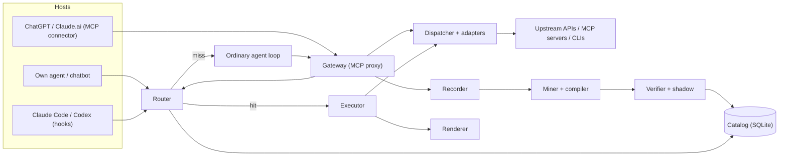
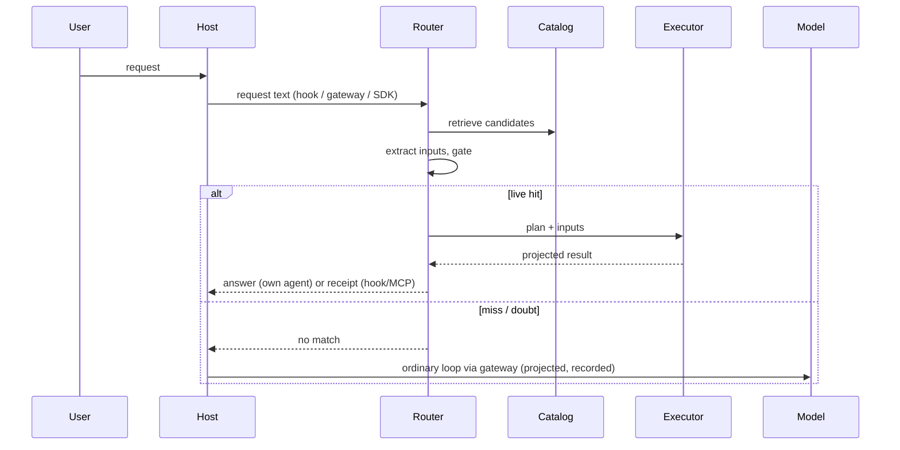

# Workflow Replay v2: architecture

Status: core implemented in `src/v2/` (see [v2-build.md](v2-build.md) for software, prerequisites, methods and what is not built yet; results in [v2-results.md](v2-results.md)). Builds on the v0.1 code in `src/` (read replay, playbook, hooks, MCP connector, approval-gated actions).

## Goal

When a request means the same thing as one handled before, run the saved procedure with the new inputs instead of letting a model re-plan it, re-call the tools and re-read raw results. Spend model tokens only on requests that are genuinely new, and learn from those so they become cheap next time.

Three savings, in order of size:

1. **Skip the model entirely** on a confident repeat (own agents only).
2. **Skip the tool loop** on a repeat inside hosts that always run a model (Claude Code, Codex, ChatGPT, Claude.ai): one compact receipt instead of several calls and raw outputs.
3. **Shrink every tool result** that still reaches a model, hit or miss (projection).

Out of scope: open-ended work such as writing code, documents or analysis. Those requests do not repeat at the plan level and fall through untouched.

## Design principles

- **Fail open to the ordinary agent.** Any doubt means fall back, never guess. A wrong replay costs more than a missed one.
- **Trusted code owns every call.** Prompts only supply typed values. Endpoints, credentials and scripts come from reviewed profiles or reviewed compiled plans.
- **Learn automatically, publish deliberately.** Candidates are mined and verified by machines; going live needs shadow agreement and, by default, a human approval.
- **Reads replay automatically; writes never do.** A plan that ends in an external action always produces an approval proposal (existing `src/actions.mjs` ledger).
- **Every answer stays askable (mandatory).** Any result the harness serves, in any mode and on any host, must be visible to the model on the user's next turn. No mode may show a result that a follow-up question cannot see. If continuity cannot be guaranteed for a request, the harness uses a mode that keeps the result in the conversation instead. See [Follow-up continuity](#follow-up-continuity).

## Components

### 1. Gateway (new, wraps existing dispatcher)

One MCP server that sits in front of the real tools. Upstream sources are registered in a profile: HTTPS endpoints (existing `httpsDispatcher`), other MCP servers (generalise `src/mcp-action.mjs` into read and action adapters), and fixed CLI commands.

- Exposes **compiled tools** (one per live workflow, e.g. `sales_summary(customer, month)`) plus the **atomic upstream tools** for misses.
- **Projects every result** to the registered fields before it reaches a model. This alone cut tokens 43% in the v0.1 runs.
- Every call passes through, so every call can be recorded. This is what removes hand-written profiles for learning.

### 2. Recorder (extends `startRecording`)

Records each agent episode as a trace: request text, tool calls with symbolic references, projected results, final answer, success signal.

- Stores structure, not data: argument provenance (`input`, `step.field`, constant) and value hashes. Raw bodies stay out of the catalog, as in v0.1.
- Sources: the gateway (all hosts), `PostToolUse` hooks in Claude Code and Codex, and existing session transcripts for back-filling.
- Success signal: no tool error, user did not retry or correct, optional thumbs-up.

### 3. Miner and compiler (new; reuses `compile`, `fingerprint`)

Runs offline on a schedule.

1. **Label each argument by where its value came from**: from the request (the value appears in the prompt), from an earlier step (equals a returned field), constant, or converted (the model transformed request text, such as "last month" into a date range).
2. **Cluster** traces by tool-sequence shape first (existing `fingerprint` and operation-set categories), then by request embedding within a shape. Shape is the primary signal because similar wording can hide different tasks and different wording can hide the same task.
3. **Infer parameters** by diffing traces in a cluster: values that vary with the request text are inputs; values that never vary are constants; values copied from earlier results are step references. One trace cannot answer this; three or more can.
4. **Record discriminators**: words and phrases that separate this cluster from its nearest neighbours ("excluding returns", "latest", "by region", "and email it"). They become router gate rules.
5. **Require support**: at least 3 successful traces, at least 2 distinct input values, and a shared core of steps across most members. Otherwise publish nothing.
6. **Synthesise a plan** in one of two forms:
   - **Graph plan** (existing JSON DAG): fixed call graph, typed bindings. Preferred when it fits.
   - **Script plan** (new, Code Mode style): a short function written by a model against typed tool bindings, for pagination, loops, filters and totals. Replaces the hand-written collectors the v0.1 audit benchmark needed.
7. **Write the route contract**: typed input schema, example requests, discriminators, output schema, response template and attention rules.

Known limit, fixed by consolidation below: if every trace in a cluster happened to use the same value (all about ACME), the miner treats it as a constant and the plan is narrower than the real task. This fails safe, because other values fall back to the agent.

### 3b. Consolidation (routine; extends `playbook.mjs` compaction)

A scheduled pass over the **catalog** (saved plans, not raw traces), nightly or after every N new routes. It compares plans with each other and chooses one of three outcomes for each set of similar plans.

| Outcome | When | Result |
| --- | --- | --- |
| **Merge** into one parameterised plan | Same shape; differences are only literal values (`customer=ACME` vs `customer=Globex`, `includeReturns=false` vs `true`) | Each differing literal becomes a typed placeholder. Old routes are repointed to the merged plan. |
| **Group** under a category | Same core, but steps or outputs differ (one adds a returns filter, one adds a region breakdown) | A shared sub-plan for the common prefix, with variants that keep their own steps, discriminators and outputs. No optional branches inside one plan. |
| **Leave apart** | Similar text but different shape, or merging would need branching logic | No change. Recorded so the pass does not retry every run. |

**How plans are compared**

- Graph plans: normalise step names (the existing compiler already orders steps deterministically), then compare operations, dependency edges and argument provenance. Literals are pulled out so two plans that differ only in literals produce the same skeleton.
- Script plans: compare the sequence of tool-binding calls and the normalised syntax tree with literals pulled out. A model may propose a merged script; it is accepted only if it passes the verification below.
- Candidates are found with the existing operation-set categories, then text similarity of descriptions and examples within a category. Similarity only proposes; structure decides.

**Merge safety**

Merging widens what a route accepts, so it is treated like a new route:

1. **Replay every member's examples** through the merged plan with that member's values filled in. Outputs must be identical to each member's verified outputs.
2. **Placeholder domain starts narrow**: a new placeholder accepts only the values seen in the merged members (an allowed list). It widens to the full type (any customer ID) after shadow agreement on unseen values or after a person approves.
3. **Router contract is rebuilt**: union of examples, discriminators recomputed against neighbouring routes, near-miss suite re-run.
4. **Publish in one transaction** with a new version. Old routes point to the merged plan by content hash; previous versions stay for rollback.
5. **Shadow before serving**: merged plans go back through shadow mode, the same as new ones.

**What it fixes**

- The coincidence problem: "ACME sales" and "Globex sales", each learned with a constant customer, merge into one `sales(customer, month)` plan.
- Catalog sprawl: many near-duplicate routes collapse into a few plans and categories, which keeps routing fast and unambiguous.
- Partial reuse: shared sub-plans from grouping are what the router uses for partial hits.

### 4. Verifier and shadow (new)

A candidate moves through states stored in the catalog:

`candidate → verified → shadow → live → retired`

- **verified**: replays held-out traces from its cluster and matches their answers exactly.
- **shadow**: on real traffic the router runs the plan alongside the ordinary agent and compares answers without serving the replay. Promote after N agreements and zero disagreements (default N = 20).
- **live**: served. Approval by a person is the default gate; teams can allow auto-promotion for read-only plans.
- **retired**: automatically on schema drift, repeated failures or a shadow disagreement.

### 5. Catalog (extends `src/playbook.mjs`)

Existing tables keep content-hashed plans, graphs, routes and the FTS index. Add:

- route state, version, permission scope, owner
- input schema, example requests, embeddings, discriminators
- response template
- stats: hits, fallbacks, shadow agreement, last failure, tokens saved
- **sub-plans**: shared prefixes (e.g. "resolve customer → account") stored once and referenced by many plans, so a partial match can still skip work.

Catalogs are partitioned by tenant and credential scope. A team shares one catalog per scope, so a plan learned from one person serves everyone allowed to run it.

### 6. Router (replaces regex-first routing; keeps `local-routing.mjs` gates)

Four steps, all cheap:

1. **Retrieve**: FTS (existing) plus embedding search over example requests. Top 3 candidates.
2. **Extract**: fill the candidate's typed inputs. Use the hand-written contract when one exists; otherwise a small model with a strict JSON schema. No free text leaves this step.
3. **Gate**:
   - every meaningful span of the request maps to an input or to known filler for that route (coverage check);
   - no discriminator conflict (e.g. "latest" vs a specific ID, "this month" vs "last month", extra filters or extra actions);
   - exactly one candidate passes (existing ambiguity rule);
   - inputs pass the plan's schema (existing `checkWorkflow`).
4. **Decide**: live route → execute; shadow route → execute in shadow and fall back; anything else → fall back.

The existing near-miss benchmark (`eval/routing-*`, 0 unsafe replays) becomes the regression gate for every router change.

### 6b. Mid-turn routing (routes on the model's planned actions)

The prompt is not the only routing signal. When the model decides what to do ("I will look up ACME's sales for October"), that decision can also be routed to a saved workflow. The reasoning tokens spent before the decision are already used; the savings come from skipping the rest of the chain: the follow-up tool calls, their raw results, and the extra model turns, each of which re-sends the whole conversation.

Route on the **planned action** (the structured tool call), not on the reasoning prose. Tool calls are typed and reliable. Prose is not: models sometimes say one thing and do another, thinking can be hidden or summarised, and most hosts do not expose it to hooks while the turn is running.

Three intercept points, from most to least robust:

| # | Intercept point | How it works | Hosts |
| --- | --- | --- | --- |
| 1 | **The model's tool choice** | Live workflows are offered as compiled tools behind one search tool (`find_workflow(intent)`) so the tool list stays small. When the model plans "look up sales", it picks the compiled tool instead of four atomic calls. | All hosts with MCP |
| 2 | **The first atomic call (prefix match)** | The gateway (or a `PreToolUse` hook in Claude Code and Codex) sees the first call of a known plan, e.g. `customer_lookup(name="ACME")`. If the gate passes, it runs the whole plan and returns the full projected result with that first call, so the model does not need to make the remaining calls. | All hosts via the gateway; hooks where supported |
| 3 | **Streamed intent text** | In agents you run yourself, watch the model's streamed text before its tool call ("I'll check ACME's October sales"). Use it only as an early hint to pre-fetch, never as the sole trigger. | Own agents only |

**Gate for mid-turn routing**

- Combine signals: the user's original request, the planned call and its arguments, and the conversation's recent carry entries. All must agree with one live route.
- Use learned odds: the miner records, per plan, how often traces that start with this call go on to complete the full plan with matching arguments. Speculate only when that rate is at least 90% and the plan is read-only.
- On doubt, do nothing special: run the single call normally (projected) and let the model continue.
- Never speculate into a write. A plan that ends in an action still stops at an approval proposal.
- Bound the extra data: the full-plan result must fit the receipt cap. Over-fetching on a wrong guess costs a little context, never correctness, because plans are read-only.

**How the result reaches the model**

- Gateway: the speculative result is part of the tool result for that first call, labelled as "this call plus the follow-ups a saved workflow normally makes".
- Hooks: prefer the gateway path. A `PreToolUse` hook that blocks a call and returns data as the block reason works in some hosts, but models can treat it as an error and retry, so use it only where testing shows the model accepts it.
- Results are tool results, so they stay in the conversation and satisfy follow-up continuity.

**What it adds to learning**

- The recorder already captures tool calls; the miner adds per-plan prefix statistics ("after call A with these argument sources, call B and C follow 94% of the time").
- Consolidation's shared sub-plans double as prefixes: a partial match on a shared prefix can return just that prefix's results.

### 7. Executor (existing `execute` + new sandbox)

- Graph plans: existing bounded-concurrency executor.
- Script plans: run in an isolate with no ambient network, file or process access (for example a Deno or workerd process with all permissions denied). The only I/O is calls to dispatcher-backed bindings, so the same allow-list, read-only rule, size caps and auth apply.
- Time and call budgets per plan; abort on any schema mismatch.
- Optional short-TTL response cache for identical upstream GETs.

### 8. Renderer (new)

Three output modes. All of them obey [follow-up continuity](#follow-up-continuity).

- **Direct** (own agents): render the answer from the route's response template and return it. Zero model calls. The host appends both the rendered answer and the structured result to the conversation history.
- **Show-and-carry** (Claude Code, and Codex where its hook can block a prompt): the prompt hook blocks the prompt, shows the rendered answer to the user, and saves the result to the session carry store. Zero model calls for that turn.
- **Inject** (hooks and MCP, today's behaviour): return the compact receipt (existing `compactReceipt`, 4 KB cap) as added context or a tool result, and let the host's model phrase it. The result is in the conversation from the start.

Each route also carries **attention rules**, generated with the route and reviewed at promotion: conditions such as empty results, nulls, values outside the range seen in training traces, or route-specific flags (for example `overdue > 0`). When a rule fires, the renderer skips Direct and Show-and-carry and uses Inject, so the model sees the outlier and can explain it in the same turn.

### Follow-up continuity

Mandatory for every mode that answers without the model.

**Show-and-carry, step by step**

1. The hook replays the request and renders the answer.
2. Before blocking, it appends `{request, route, result, time}` to the carry store for that session, keyed by the hook's `session_id`. If the write fails, it does not block; it falls back to Inject.
3. It blocks the prompt and shows the answer to the user.
4. On the next prompt in the same session that reaches the model, the hook adds every undelivered carry entry as context ("Earlier in this session the harness answered: …"), then marks them delivered. Once delivered, the entries are part of the transcript and survive compaction like any other context.
5. If the next prompt is itself another Show-and-carry hit, entries keep accumulating and are all delivered on the next model turn.

**Limits that protect the guarantee**

- Each entry is at most 4 KB, and the undelivered total is at most 12 KB. If a new result would exceed the cap, that request uses Inject instead of blocking. Results are never dropped to make room.
- Results whose attention rules fire always use Inject.
- If the host does not provide a session ID, or its hook cannot block, the route uses Inject.

**Storage**

- `~/.workflow-replay/sessions/<session_id>.json`, owner-only permissions, never written to the catalog.
- Cleared at session end (`SessionEnd` hook where available) or after 24 hours.
- Treated as sensitive: it holds fetched data.

**Other hosts**

- Own agents: the rendered answer and structured result go into history (Direct mode above).
- ChatGPT, Claude.ai and MCP use: results are tool results, already in the conversation.

### 9. Actions (existing `src/actions.mjs`)

A plan may end in an action. Replay prepares the proposal with fresh reads, then the existing ledger enforces approval, one-time dispatch, expiry and idempotency. Profiles for read-only systems (such as the company ERP) must not register any action tools.

### 10. Telemetry

Per route and per host: hit rate, fallback reasons, shadow agreement, wrong-replay count, uncached input tokens and dollars per correct answer, latency. This feeds retirement and the payback report.

## Request flow

## Host support

| Host | Where it plugs in | Skip tool loop | Skip model | Auto-learn |
| --- | --- | --- | --- | --- |
| Own agent / chatbot | SDK call before the model; gateway for tools | Yes | Yes | Yes |
| Claude Code / Codex | `UserPromptSubmit` hook; gateway as MCP server; `PostToolUse` recording | Yes | Yes with Show-and-carry where the hook can block (follow-ups keep the result); otherwise Inject | Yes, for calls through the gateway or seen by hooks |
| ChatGPT / Claude.ai (paid plans with custom connectors) | Remote MCP gateway | Yes, when the model picks the compiled tool | No | Only calls made through the gateway |
| Free consumer chat apps without connectors | None | No | No | No |

## Reuse map

| v0.1 module | v2 role |
| --- | --- |
| `workflow.mjs` (`compile`, `execute`, dispatchers) | Graph plans, executor, HTTPS adapter |
| `playbook.mjs` | Catalog base; add states, stats, embeddings, sub-plans; its fingerprint and operation-set categories seed consolidation |
| `local-routing.mjs`, `host-routing.mjs` | Router gate and fallback; assisted mode becomes default extractor |
| `prompt-hook.mjs`, `install.mjs` | Claude Code / Codex integration; add `PostToolUse` recorder |
| `mcp-service.mjs`, `mcp.mjs` | Gateway server and OAuth; expose compiled tools |
| `mcp-action.mjs` | Generalise to read + action MCP adapters |
| `actions.mjs` | Unchanged; terminal step for write plans |
| `eval/` | Near-miss gate, shadow scoring, payback reports |

New: gateway proxying, recorder store, miner, script sandbox, verifier/shadow, embeddings, response templates, telemetry.

## Roadmap

0. **Measure the ceiling (1 week).** Collect real agent logs, cluster requests, report the share covered by the top 20 and top 50 clusters. Continue only if the top 50 cover roughly 30% or more of requests or tokens.
1. **Gateway + projection + recording.** Immediate savings on every call, and the data for later phases.
2. **Assisted routing.** Embedding retrieval, small-model extraction, coverage and discriminator gates. Grow the near-miss suite to several hundred cases. Add compiled tools behind `find_workflow` (mid-turn intercept 1).
3a. **Prefix speculation in the gateway** (mid-turn intercept 2), once prefix statistics exist. Measure turns and tokens skipped versus wrong speculations.
3. **Auto-compile graph plans + shadow mode + consolidation for graph plans.** First fully learned routes; routine merge and grouping keeps them general.
4. **Script plans in a sandbox.** Pagination, loops and totals without hand-written collectors.
5. **Sub-plans, team catalogs, response templates, attention rules, Show-and-carry.** Show-and-carry ships only with its continuity tests: block → follow-up sees the result; store write failure → Inject; cap exceeded → Inject; attention rule fires → Inject.

First deployment: read-only lookups against the company ERP through the gateway (GET only, no action tools), then a customer-facing or internal support agent where skipping the model matters most.

## Success metrics

- Wrong replays: 0 per 1,000 served (hard gate).
- Hit rate on eligible traffic and fallback reasons.
- Uncached input tokens and cost per correct answer, versus the same agent without the harness, including learning and shadow costs.
- p50 latency on hits.

## Risks

- **Low repetition**: if requests do not cluster, savings stay small. Phase 0 checks this first.
- **Near-miss errors**: similar wording, different meaning. Mitigated by coverage and discriminator gates, shadow mode and the regression suite.
- **Stale plans**: upstream changes. Mitigated by schema checks, versioning and auto-retirement.
- **Script safety**: compiled scripts are code. Mitigated by isolation, binding-only I/O, review before promotion.
- **Host limits**: hosted chat apps decide whether to call the tool; savings there depend on tool descriptions and the host's choices.
- **Wrong speculation mid-turn**: a prefix match guesses the wrong follow-up. Read-only plans make this a context cost, not a correctness error; the 90% rule and per-plan tracking keep it rare, and plans with frequent misses lose speculation.
- **Lost follow-up context**: a zero-model answer the model never sees. Prevented by the mandatory continuity rule; any mode that cannot guarantee it falls back to Inject.
- **Hook behaviour varies by host and version**: confirm blocking, session IDs and session-end hooks in the current Claude Code and Codex hook docs before shipping Show-and-carry, and test each host separately.
