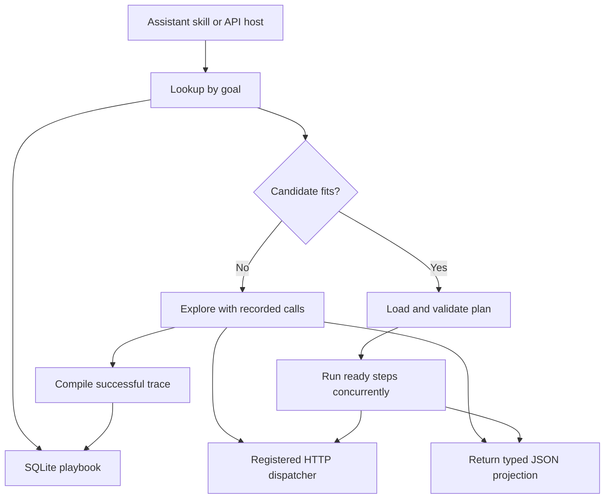

# Workflow replay harness

> **v2** (`src/v2/`) learns workflows automatically from recorded agent traffic, merges similar ones, promotes them through shadow mode, and replays repeats before or during the model's turn. See [architecture](docs/architecture-v2.md), [build spec](docs/v2-build.md) and [benchmark results](docs/v2-results.md). On τ²-bench retail and airline records with DeepSeek V4.1 Flash, with the model still writing every answer from a compact receipt, it used 38% fewer tokens overall (about 17% lower cost), 69–95% fewer on repeat tasks, at 100% accuracy versus 99.3% for the plain agent. Skipping the model on hits (opt-in) saves more: 42% fewer tokens, 30% lower cost. The v0.1 documentation below still applies to `src/`.

Save successful read-only HTTP workflows, replay them against fresh inputs, and return only the requested fields. The runner uses Node.js 24 or later and SQLite. It keeps route lookup and typed input binding local.

## Quick start

From the downloaded repository, install the pinned dependencies and seed a synthetic profile.

```sh
npm ci
npm run demo:seed
```

From the project where you want automatic replay, run the installer using the absolute path to this repository's `install.mjs`.

```sh
node /path/to/workflow-replay/install.mjs codex --project . --profile replay-demo
# For Claude Code, use claude in place of codex.
```

In Codex, review and trust the hook in `/hooks`. Start a local session in the bound project and ask **How many pencils are in the demo inventory?** The prompt hook resolves the saved workflow and supplies the compact answer before the model chooses tools. Ordinary prompts and unsupported variants proceed without added context. The demo uses synthetic data.

| Host | Integration |
| --- | --- |
| Codex and Claude Code | One-time [local hook setup](docs/installation.md). The hook checks each prompt in bound workspaces. |
| Claude Desktop | [Local stdio MCP server](docs/installation.md#local-mcp). |
| Hosted ChatGPT and Claude | [Self-hosted remote MCP connector](docs/remote.md), enabled in the host. The host controls tool selection. |
| A chatbot you control | Call [the JavaScript integration](docs/installation.md#custom-chatbot) before sending the request to the model. |

The hooks let the host's model answer using a compact receipt. The MCP connector returns that receipt as one tool result. A chatbot you control can return the receipt directly on a match and skip the model call entirely. New workflows are recorded through the trusted dispatcher and saved after a successful capture. Configure real services using the [profile guide](skills/workflow-replay/references/profiles.md).

For actions such as sending a message or updating a record, register an [approval-gated workflow](docs/actions.md). The runner returns typed placeholders for the assistant to fill, prepares the exact call for review, and dispatches the approved action through a configured adapter. The local MCP server can expose preparation as a tool. A trusted application or local terminal handles approval and execution.

Run `npm test` to check the installers, routing, execution and MCP transports locally. See [Security](SECURITY.md) before exposing a connector. The repository includes a Windows, macOS and Linux CI matrix.

## Run the test bench

```powershell
npm.cmd ci
npm.cmd test
npm.cmd run bench
```

For live A/B results with DeepSeek V4.1 Flash via ModelArk, see the [research prompts and evaluation runner](eval/README.md).
Run `npm.cmd run bench:scale` to compare host-routed replay with compact direct calls on short tasks and 5-, 25- and 100-order audits.
Run `npm.cmd run bench:routing` for the local paraphrase and near-miss routing comparison.

On macOS or Linux use `npm`. Tests and benchmarks start their own HTTP fixtures on ephemeral ports. The local CLI and prompt hook use Node built-ins. The MCP connector uses the MCP SDK, Zod, and jose.

### Try a persistent playbook

In one terminal, start the fixture.

```powershell
node --disable-warning=ExperimentalWarning cli.mjs fixture
```

In another terminal in the same workspace, run the following.

```powershell
node --disable-warning=ExperimentalWarning cli.mjs learn account-health "Account health summary" examples/account-health.json examples/alpha.json
node --disable-warning=ExperimentalWarning cli.mjs lookup "account health"
node --disable-warning=ExperimentalWarning cli.mjs run account-health examples/beta.json
node --disable-warning=ExperimentalWarning cli.mjs playbook
```

The first call returns `{"tier":"pro","overdue":2,"open":4}` inside its publish receipt. Replay returns `{"open":1,"overdue":0,"tier":"basic"}` for a different customer. Both fetch fresh data. The default database is `.replay/playbook.sqlite`. Set `REPLAY_DB` to use another path. Redirect `playbook` to a Markdown file to export the current catalog. Each route points to a plan by its content hash.

## Architecture



| Layer | Implementation |
| --- | --- |
| Skill | [Workflow replay skill](skills/workflow-replay/SKILL.md) directs the assistant to lookup, run, or learn. |
| Dispatcher | Versioned operation IDs map to trusted paths, argument types and return fields. The supplied adapter uses GET on a configured loopback origin, rejects redirects, and caps response size. |
| Capture | `startRecording` lets an application call one operation at a time during discovery. A call uses symbolic references and enters the trace after its response passes validation. `finish` projects the result and compiles the successful trace. The CLI's `learn` exercises the same path from a supplied spec. |
| Plan | A versioned JSON DAG interpreted by the harness. Each argument names an input or a field from an earlier step. The output maps named fields to typed operation results. The stored plan contains symbolic bindings. Actual inputs and response bodies stay outside the catalog. |
| Playbook | SQLite publishes the graph, projection, route and full-text index entry in one transaction. A matching route can be used directly. Lookup returns up to three candidates with descriptions, required inputs and output fields. The Markdown view is derived from SQLite. |
| Replay | Validate the plan against the current registry and inputs, fetch fresh results, and use bounded async batches for ready steps. Return only the named projection. On an HTTP or schema failure, abort the active batch and fail the run. |

### Capture and consolidation

The app hosting the tools must own or wrap the dispatcher to capture the tool calls. Pass explicit input and step references at that boundary. An observed request containing a customer ID cannot establish whether that ID was user input, a prior result, or a constant.

`examples/account-health.json` shows the representation. `account.v1` resolves the customer, then `billing.v1` and `support.v1` depend on the account ID. The compiler renames steps and orders independent calls deterministically. The graph fingerprint covers operation versions, bindings and input types. The plan fingerprint also covers the output projection. Two aliases for the same canonical plan share one record. Plans with the same steps and different projections share an executable graph. Plans with the same operation set appear in the same category. This compaction happens on each publish.

For a larger catalog, group candidate plans by capability and dependency shape, then use text similarity within each group to surface candidates for review. Similarity can propose a parameterized template or shared subgraph. Before repointing routes, verify the argument and output contracts, compare fixture results for each old route, and publish a new version transactionally. Start with exact structural deduplication because it has a clear correctness criterion. The prototype implements exact canonical matching and operation-set categories. Semantic clustering and subgraph extraction are design extensions.

### Integrate your tool dispatcher

To learn workflows inside your own API agent, wrap the host's client-tool handler with `startRecording` and publish the plan after a successful run. The prompt hooks and MCP connector replay existing workflows. Calls made through other tools are outside their capture path. [OpenAI function tools](https://developers.openai.com/api/docs/guides/agents-api/tools/functions) · [Claude client tools](https://platform.claude.com/docs/en/agents-and-tools/tool-use/overview)

Register and version each connector in trusted code and enforce current principal and scope on every invocation. Partition catalogs by principal or tenant. Keep response data out of route metadata. Automatic replay supports read-only DAGs and bounded scalar results. Approval-gated workflows can use a read DAG to prepare one external action. General branching, pagination and multi-action transactions need a dedicated adapter or the ordinary tool loop.

## What the benchmark measures

Every mode must produce the expected output on both demo accounts. All modes make the same three HTTP requests. The modes isolate serial execution, parallel execution with raw responses, parallel execution with small tool responses, replay with catalog lookup, and replay with a known route. The verbose fixture adds irrelevant history. The lean fixture returns only registered fields. The catalog exercise uses 1,000 synthetic routes with five output contracts and measures lookup time and the number of distinct plans and graphs.

`o200k_base` counts the text of the modeled tool calls and results, including replay lookup when applicable. Latency measures local execution. Tool counts exclude model prompts, history replay, tool declarations, reasoning and provider wrappers. The benchmark simulates the agent's tool choices and runs real HTTP requests. It uses zero hosted model calls. The payback estimate treats the standalone learn command's tool text as an extra one-time cost on top of ordinary discovery, then divides by tool text saved per repeat. An integrated recording session can capture the discovery pass directly.

For a provider A/B test, run identical held-out tasks under the same model, registry and result budget, alternating order between modes. Compare direct raw, direct projected and replay. Include catalog hits, ambiguous requests, misses and changed schemas. Score answer parity and unsafe or incorrect routes before comparing latency and cumulative model usage. Sum input, output, and cached or cache-write usage across discovery, publication, lookup, replay and fallback. That establishes actual token and cost savings for the target host. [OpenAI usage accounting](https://developers.openai.com/api/docs/guides/agents-api/observability)
